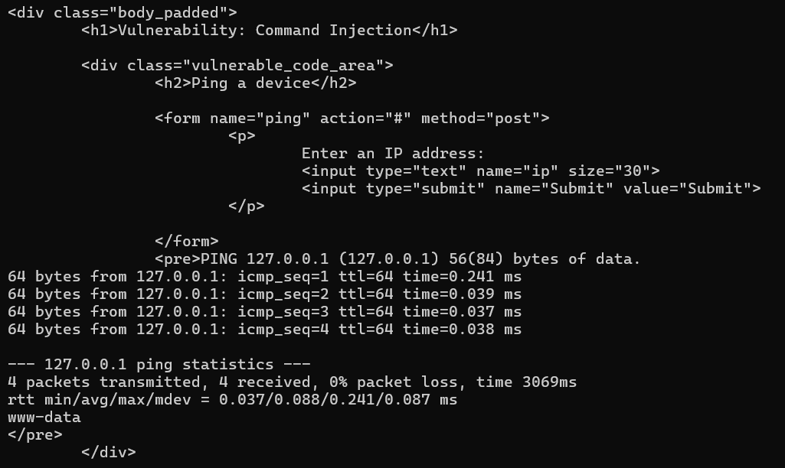
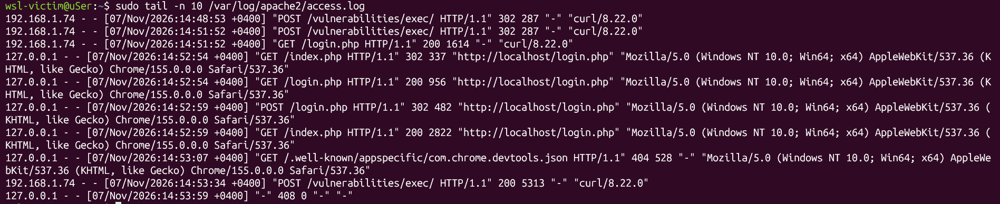
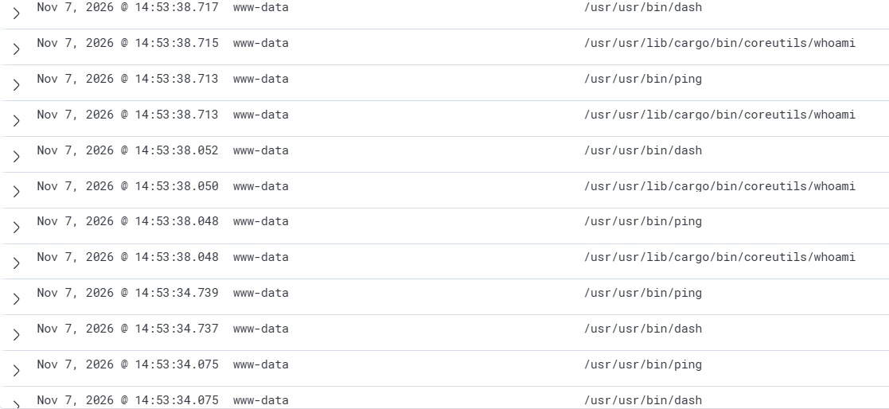

# Отчёт по симуляции веб-атак: A01:2021 — Broken Access Control / RCE (Command Injection)

Привет! Я только начинаю свой путь в практической информационной безопасности и SOC-аналитике. Для практической работы я собрал домашний стенд на WSL2, чтобы покрутить атаки из списка **OWASP Top 10** и посмотреть, как их видит синяя сторона (Blue Team). 

В этом отчёте я покажу, как провести атаку **внедрение команд** на уязвимом приложении DVWA, почему обычные логи веб-сервера нас не спасут и как связка **Sysmon для Linux + Wazuh** помогает вовремя заметить хакера.

---

## 1. Архитектура моего стенда

Все крутится на одном хосте Windows в изолированных дистрибутивах **WSL2** (сеть настроена в режиме `mirrored` для удобства):
1. **Атакующий (`kali-linux`)** — отсюда я запускаю `curl` и бью по мишени.
2. **Жертва (`victim`)** — веб-стек Apache2 + MariaDB + PHP. На нем развернут DVWA. Также тут крутится агент Wazuh и Sysmon for Linux.
3. **Аналитика (`analytics`)** — сервер Wazuh (SIEM), который собирает все алерты.

---

## 2. Симуляция атаки

Заходим в DVWA, выставляем уровень сложности **Low** и переходим в модуль **Command Injection**. Суть уязвимости: скрипт принимает IP-адрес для системного пинга, но разработчик забыл фильтровать ввод. Мы можем дописать точку с запятой `;` и выполнить любую команду в операционной системе жертвы.

Я буду атаковать прямо из консоли Kali через `curl`. Для этого я залогинился в DVWA через браузер хоста, вытащил свои куки (`PHPSESSID`) и подставил их в запрос вместе с вредоносной нагрузкой `;whoami`:

```bash
curl -s -b "PHPSESSID=6e020b25981d1b7ba9dd174cd74a8d29; security=low" --data "ip=127.0.0.1;whoami&Submit=Submit" "http://192.168.1.74/vulnerabilities/fi/?page=/etc/passwd"
```

Сервер успешно съел запрос. На экране среди кучи HTML-тегов DVWA вернул статистику пинга, а прямо под ней — чистый текст ответа операционной системы: `www-data`. Это значит, что код выполнился!



---

## 3. Анализ логов на стороне жертвы

Теперь я иду на виртуалку-жертву `victim` и смотрю, что записалось в штатный лог веб-сервера:

```bash
sudo tail -n 1 /var/log/apache2/access.log
```

Видим вот такую строчку:
```text
192.168.1.74 - - [07/Nov/2026:13:36:17 +0400] "POST /vulnerabilities/exec/ HTTP/1.1" 200 5313 "-" "curl/8.18.0"
```

### Мой вывод:
Здесь кроется главная засада! Так как атака шла через `POST`-запрос, тело запроса (наш payload `;whoami`) **не пишется в access.log**. Для обычного администратора этот лог выглядит абсолютно чистым и легитимным: кто-то зашел на страницу, сервер ответил кодом `200 OK`. Если опираться только на логи Apache, мы в упор не увидим, что сервер уже взломали.



---

## 4. Расследование инцидента в Wazuh с помощью Sysmon

Поскольку обычных веб-логов мало, у меня на жертве развернут **Sysmon для Linux**. Он сидит на уровне ядра ОС и следит за системными вызовами запуска процессов (`EventID 1`). Агент Wazuh забирает эти события и шлет их на сервер `analytics`.

Заходим в веб-интерфейс Wazuh, вбиваем в поиск `whoami` или `exec` и видим потрясающую картину — детальный посекундный таймлайн действий злоумышленника!



### Разбор хронологии (события за секунду `13:36:21`):
1. **Запуск легитимного процесса:** Веб-сервер запускает `/usr/usr/bin/ping` — это то, что DVWA должен был сделать по задумке разработчиков.
2. **Внедрение вредоносного кода:** Сисмон фиксирует, что следом от имени пользователя **`www-data`** создается подозрительный процесс `/usr/usr/lib/cargo/bin/coreutils/whoami`.
3. **Использование командной оболочки:** Мы видим запуск интерпретатора `/usr/usr/bin/dash` (штатный `sh` в Ubuntu), через который PHP-скрипт DVWA и пробросил команду хакера в систему.

> **Важная заметка про WSL2:** Если вы посмотрите на пути к бинарникам в интерфейсе Wazuh, то заметите странный префикс `/usr/usr/bin/...`. Сначала я подумал, что у меня что-то сломалось, но оказалось, что это архитектурная фича ядра WSL2. При перехвате системных вызовов внутри Windows Subsystem for Linux пути маппятся именно в таком раздутом виде через overlayfs. Это не баг, фиксить это не нужно!

---

## Заключение

Этот кейс наглядно показал мне, для чего ставить endpoint-мониторинг. 
* **Логи приложений** (в данном случае Apache) показывают только "входную дверь" — сам факт визита.
* **Логи ядра ОС (Sysmon)** показывают реальные действия внутри дома — создание процессов, запуск шеллов и системных утилит.

Для любого SOC-аналитика появление процессов вроде `dash`, `bash` или `whoami` от имени пользователя веб-сервера (`www-data`) — это железный триггер критического инцидента (RCE), который требует немедленного реагирования.
