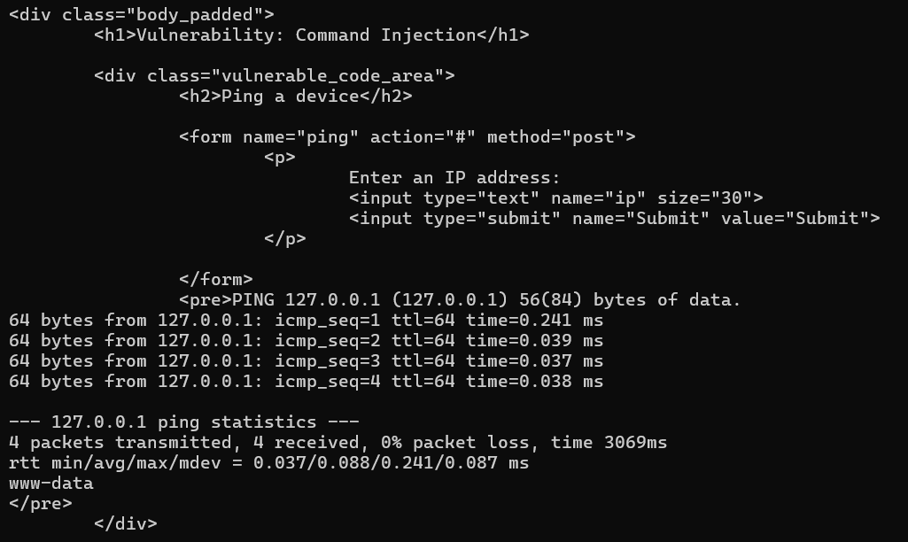
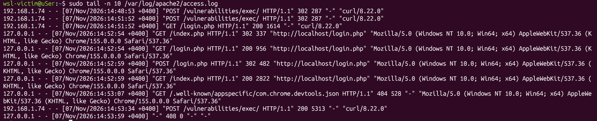
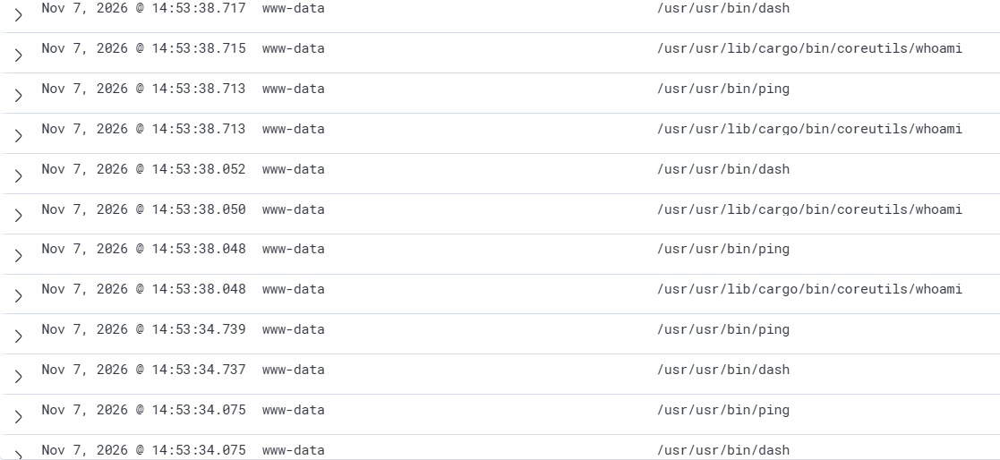
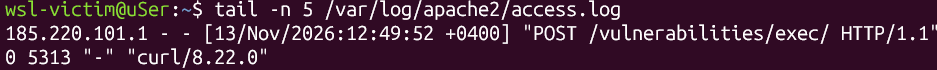
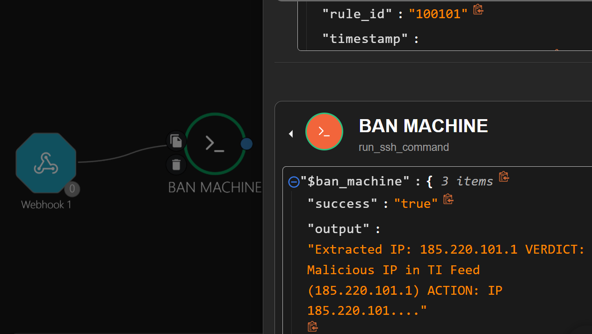
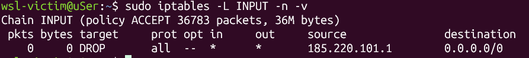

# Отчёт по симуляции веб-атак: A03:2021 — Command Injection

В этом отчёте я покажу, как провести атаку **внедрение команд** на уязвимом приложении DVWA, почему обычные логи веб-сервера нас не спасут и как связка **Sysmon для Linux + Wazuh** помогает вовремя заметить хакера.

---

## 1. Архитектура моего стенда

Все крутится на одном хосте Windows в изолированных дистрибутивах **WSL2** (сеть настроена в режиме `mirrored` для удобства):
1. **Атакующий (`kali-linux`)** — отсюда я запускаю `curl` и бью по мишени.
2. **Жертва (`victim`)** — веб-стек Apache2 + MariaDB + PHP. На нем развернут DVWA. Также тут крутится агент Wazuh и Sysmon for Linux.
3. **Аналитика (`analytics`)** — сервер Wazuh (SIEM), который собирает все алерты.

---

## 2. Симуляция атаки

Заходим в DVWA, выставляем уровень сложности **Low** и переходим в модуль **Command Injection**. Суть уязвимости: скрипт принимает IP-адрес для системного пинга, но разработчик забыл фильтровать ввод. Мы можем дописать точку с запятой `;` и выполнить любую команду в операционной системе жертвы.

Я буду атаковать прямо из консоли Kali через `curl`. Для этого я залогинился в DVWA через браузер хоста, вытащил свои куки (`PHPSESSID`) и подставил их в запрос вместе с вредоносной нагрузкой `;whoami`:

```bash
curl -s -b "PHPSESSID=c9dd9cfad98d264eee950bbbf6be5d77; security=low" --data "ip=127.0.0.1;whoami&Submit=Submit" "http://192.168.1.74/vulnerabilities/exec/"
```

Сервер успешно съел запрос. На экране среди кучи HTML-тегов DVWA вернул статистику пинга, а прямо под ней — чистый текст ответа операционной системы: `www-data`. Это значит, что код выполнился!



---

## 3. Анализ логов на стороне жертвы

Теперь я иду на виртуалку-жертву `victim` и смотрю, что записалось в штатный лог веб-сервера:

```bash
sudo tail -n 1 /var/log/apache2/access.log
```

Видим вот такую строчку:
```text
192.168.1.74 - - [07/Nov/2026:13:36:17 +0400] "POST /vulnerabilities/exec/ HTTP/1.1" 200 5313 "-" "curl/8.18.0"
```

### Мой вывод:
Здесь кроется главная засада! Так как атака шла через `POST`-запрос, тело запроса (наш payload `;whoami`) **не пишется в access.log**. Для обычного администратора этот лог выглядит абсолютно чистым и легитимным: кто-то зашел на страницу, сервер ответил кодом `200 OK`. Если опираться только на логи Apache, мы в упор не увидим, что сервер уже взломали.



---

## 4. Расследование инцидента в Wazuh с помощью Sysmon

Поскольку обычных веб-логов мало, у меня на жертве развернут **Sysmon для Linux**. Он сидит на уровне ядра ОС и следит за системными вызовами запуска процессов (`EventID 1`). Агент Wazuh забирает эти события и шлет их на сервер `analytics`.

Заходим в веб-интерфейс Wazuh, вбиваем в поиск `whoami` или `exec` и видим потрясающую картину — детальный посекундный таймлайн действий злоумышленника!



### Разбор хронологии (события за секунду `13:36:21`):
1. **Запуск легитимного процесса:** Веб-сервер запускает `/usr/usr/bin/ping` — это то, что DVWA должен был сделать по задумке разработчиков.
2. **Внедрение вредоносного кода:** Сисмон фиксирует, что следом от имени пользователя **`www-data`** создается подозрительный процесс `/usr/usr/lib/cargo/bin/coreutils/whoami`.
3. **Использование командной оболочки:** Мы видим запуск интерпретатора `/usr/usr/bin/dash` (штатный `sh` в Ubuntu), через который PHP-скрипт DVWA и пробросил команду хакера в систему.

> **Важная заметка про WSL2:** Если вы посмотрите на пути к бинарникам в интерфейсе Wazuh, то заметите странный префикс `/usr/usr/bin/...`. Сначала я подумал, что у меня что-то сломалось, но оказалось, что это архитектурная фича ядра WSL2. При перехвате системных вызовов внутри Windows Subsystem for Linux пути маппятся именно в таком раздутом виде через overlayfs. Это не баг, фиксить это не нужно!

---

## 5. Автоматическое сдерживание (Shuffle SOAR)

Задача реагирования сводится к корреляции событий ОС и веб-сервера, проверке источника атаки по базам киберразведки (**Threat Intelligence**) и автоматической блокировке IP-адреса на сетевом уровне.

### 5.1. Эмуляция внешнего атакующего IP
* **Имитация внешнего трафика:** Поскольку стенд развёрнут в изолированной локальной сети, формат логирования Apache (`/etc/apache2/apache2.conf`) был адаптирован для записи заголовка `%{X-Forwarded-For}i`. При отправке полезной нагрузки с машины `kali-linux` в запрос подставлялся реальный публичный IP-адрес выходного узла сети Tor (`185.220.101.1`).
* **Минимизация ложных срабатываний:** Уязвимый модуль DVWA штатно вызывает системную утилиту `/usr/bin/ping` от имени `www-data`. Правило корреляции Wazuh (`100101`, уровень `12`) настроено так, чтобы игнорировать легитимный `ping` и интерактивные сессии администраторов (запускаемые от `sshd`), реагируя только на порождение от имени `www-data` командных интерпретаторов (`dash`, `sh`, `bash`) и утилит разведки (`whoami`, `id`, `uname`).

```bash
curl -s -H "X-Forwarded-For: 185.220.101.1" \
  -b "PHPSESSID=<SESSION_ID>; security=low" \
  --data "ip=127.0.0.1;whoami&Submit=Submit" \
  "http://192.168.1.74/vulnerabilities/exec/"
```



### 5.2. Логика плейбука в Shuffle SOAR
При срабатывании правила `100101` менеджер Wazuh передаёт JSON-алерт по вебхуку в платформу **Shuffle**, которая выполняет три шага:

1. **Корреляция логов:** По SSH плейбук обращается к `/var/log/apache2/access.log` на сервере `victim` и извлекает IP-адрес из последней POST-записи к модулю `exec`, связывая процесс из телеметрии Sysmon с сетевым запросом.
2. **Проверка репутации:** Извлечённый IP сверяется с локально кэшируемым списком индикаторов компрометации (`/etc/security/ti_blacklist.txt`).
3. **Сдерживание:** Выполнение одной инъекции `;whoami` порождает цепочку дочерних процессов (`sh` → `dash` → `whoami`), вызывая серию из нескольких алертов Sysmon подряд. Чтобы избежать дублирования правил в файрволе при множественном срабатывании плейбука, перед добавлением правила выполняется проверка его наличия (`iptables -C`):

```bash
grep -E "POST .*exec" /var/log/apache2/access.log | tail -n 1 | cut -d' ' -f1 | \
xargs -I {} sh -c 'echo "Extracted IP: {}"; \
if grep -qx "{}" /etc/security/ti_blacklist.txt; then \
  echo "VERDICT: Malicious IP in TI Feed ({})"; \
  sudo iptables -C INPUT -s "{}" -j DROP 2>/dev/null || sudo iptables -A INPUT -s "{}" -j DROP; \
  echo "ACTION: IP {} blocked via iptables"; \
else \
  echo "VERDICT: Clean ({})"; \
fi'
```



### 5.3. Проверка эффективности сдерживания
Через несколько секунд после фиксации инцидента проверка таблицы правил `iptables` на целевом сервере подтвердила успешную автоматическую блокировку атакующего узла без дублирования записей:

```bash
sudo iptables -L INPUT -n -v
```



---

## 6. Как защититься

Чтобы закрыть эту уязвимость, разработчикам и администраторам нужно сделать три простые вещи:

1. **Проверять ввод пользователя (белый список):** Сайт ждёт от пользователя только IP-адрес, но принимает вообще любую строку. Нужно проверять на уровне кода, что в поле ввели именно корректный IP-адрес (4 числа через точку), а если там есть буквы, точки с запятой `;` или пробелы — сразу отклонять запрос.
2. **Не запускать системные команды напрямую из сайта:** По возможности не использовать в коде сайта функции вроде `shell_exec()`, которые передают текст прямо в терминал Linux. Лучше использовать встроенные функции самого языка программирования для проверки сети.
3. **Ограничить права пользователя `www-data`:** Даже если хакер пробил сайт, пользователь `www-data` должен иметь минимальные права в системе — только чтение файлов самого сайта, без доступа к системным настройкам и возможности менять файлы.

---

## Заключение

Этот кейс отлично показал, что одних логов веб-сервера (`access.log`) недостаточно для защиты: при `POST`-запросах Apache видит только факт обращения к странице, но не видит, какие команды выполнились внутри системы.

Связка **Sysmon для Linux + Wazuh** закрыла эту слепую зону на уровне ядра ОС, а плейбук в **Shuffle SOAR** позволил автоматически сопоставить процесс с логом веб-сервера, проверить IP атакующего по базе угроз и заблокировать его в `iptables` за пару секунд без участия человека.

