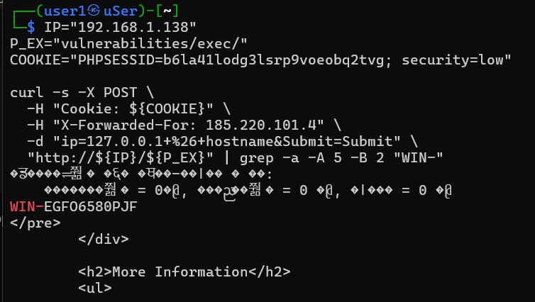
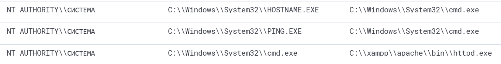
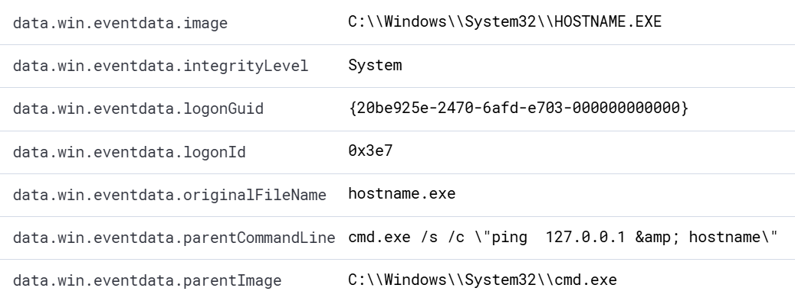
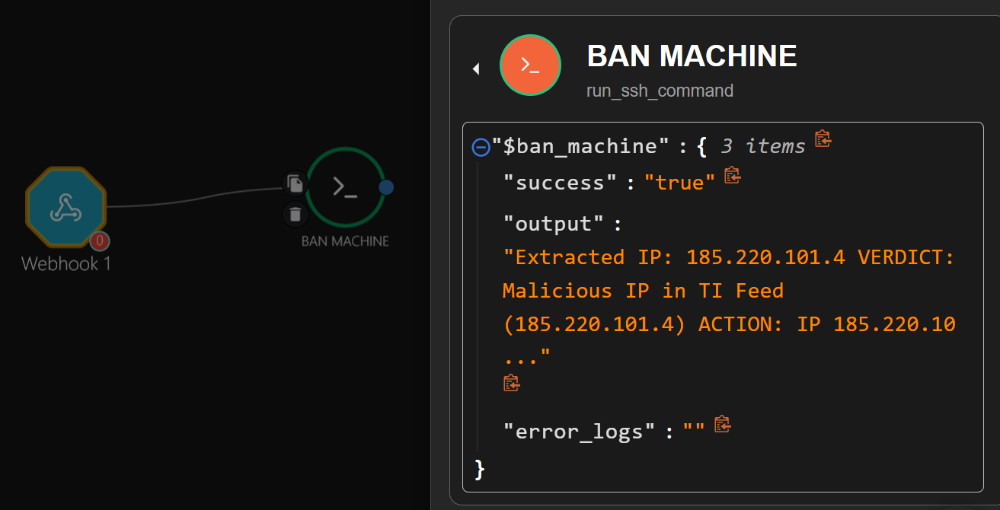

# Отчёт по симуляции веб-атак: A03:2021 — Command Injection (Windows Server 2019)

В отчёте рассматривается эксплуатация уязвимости инъекции команд ОС в DVWA на Windows Server 2019, её обнаружение через телеметрию Sysmon и Wazuh SIEM, а также автоматическая блокировка злоумышленника посредством Shuffle SOAR.

## 1. Сценарий атаки: Инъекция системных команд

Атака выполнена с `kali-linux` (`192.168.1.74`) на `win-victim` (`192.168.1.138`) в уязвимом модуле `/vulnerabilities/exec/` с использованием заголовка `X-Forwarded-For: 185.220.101.4` для имитации трафика через Tor.

### Пример запроса:
```bash
IP="192.168.1.138"
curl -s -X POST \
  -H "Cookie: PHPSESSID=b6la41lodg3lsrp9voeobq2tvg; security=low" \
  -H "X-Forwarded-For: 185.220.101.4" \
  -d "ip=127.0.0.1+%26+hostname&Submit=Submit" \
  "http://${IP}/vulnerabilities/exec/"
```
**Итог:** Помимо выполнения команды `ping`, сервер обработал внедрённую инструкцию `hostname`, возвратив имя хоста `WIN-EGFO6580PJF` от имени `SYSTEM`.



## 2. Анализ логов сервера

В логе веб-сервера `C:\xampp\apache\logs\access.log` зафиксирован POST-запрос с внешнего IP-адреса:
`185.220.101.4 - - [18/Nov/2026:11:22:02 +0300] "POST /vulnerabilities/exec/ HTTP/1.1" 200 5099 "-" "curl/8.22.0"`
Журнал отмечает сам факт запроса и код `200 OK`, но не отображает содержимое вредоносной полезной нагрузки.

## 3. Расследование инцидента (Sysmon и Wazuh)

* **Телеметрия Sysmon (EventID 1):** Зафиксирована аномальная цепочка запуска процессов, где веб-сервер (`httpd.exe`) инициирует оболочку `cmd.exe /s /c "ping 127.0.0.1 & hostname"` от лица `NT AUTHORITY\СИСТЕМА`.
* **Детект в Wazuh SIEM:** Сработало правило **`100201`** (Level 12) с привязкой к технике MITRE ATT&CK **`T1059.003`** (Windows Command Shell).




## 4. Автоматическое сдерживание по Threat Intelligence (Shuffle SOAR)

При получении алерта `rule.id: 100201` Wazuh инициирует воркфлоу **`Win-A03-TI-Block`**:
1. **Webhook:** Принимает событие от SIEM.
2. **Блокировка (`BAN MACHINE`):** Скрипт `soar_block.ps1` извлекает IP `185.220.101.4` из `access.log`, сверяет его с локальным фидом `ti_blacklist.txt` и добавляет блокирующее правило `SOAR_Block_185.220.101.4` в **Windows Firewall**.

**Логика скрипта реагирования (`C:\security\soar_block.ps1`):**
```powershell
$line = (Get-Content 'C:\xampp\apache\logs\access.log' | Select-String 'POST .*exec' | Select-Object -Last 1).ToString()
$ip = $line.Split(' ')[0]

if (Select-String -Path 'C:\security\ti_blacklist.txt' -Pattern "^$ip" -Quiet) {
    New-NetFirewallRule -DisplayName "SOAR_Block_$ip" -Direction Inbound -RemoteAddress $ip -Action Block -ErrorAction SilentlyContinue | Out-Null
    Write-Output "ACTION: IP $ip blocked via Windows Firewall"
}
```




## Рекомендации по защите
1. Валидировать входные данные на уровне приложения (использовать фильтры вроде `filter_var($ip, FILTER_VALIDATE_IP)`).
2. Отказаться от прямых вызовов системных оболочек (`shell_exec`, `system`).
3. Понизить привилегии службы Apache с `NT AUTHORITY\SYSTEM` до отдельного сервисного аккаунта с ограниченными правами.
